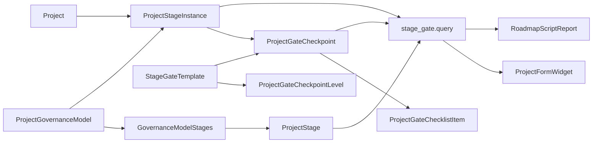

# Dinext Project Stage Gate

## 📖 Overview

`dinext_project_stage_gate` adds a dedicated Stage-gate governance layer on top of standard ERPNext `Project` records. The app keeps `Project` as the main business object and introduces separate metadata and transactional DocTypes for stage registries, governance models, gate templates, stage execution, checkpoint approvals, and roadmap reporting.

The implementation is intentionally independent from the standard `Project` workflow and from `Task Type = Stage/Phase`. Tasks, issues, and existing portfolio links can still be used as related evidence, but the source of truth for governance progression lives in the Stage-gate domain model.

## ✨ Features

- Dedicated master data for `Project Stage`, `Project Governance Model`, `Stage Gate Template`, and `Project Gate Checkpoint Level`
- Transactional execution layer with `Project Stage Instance`, `Project Gate Checkpoint`, and `Project Gate Checklist Item`
- Whitelisted Python API for project stage-chain and roadmap datasets
- Project form widget rendered via `doctype_js`, without requiring a custom HTML field
- Stage-gate roadmap Script Report with lazy-loaded ECharts rendering
- Role and permission model for `Stage Gate Owner`, `Stage Gate Reviewer`, `Stage Gate Approver`, and `Project Governance Admin`
- Dedicated checkpoint workflow that does not modify the existing `Project` approval flow
- Backfill utility for migrating old naming fields and checkpoint levels to the current canonical model

## 🚀 Installation

Install the app into an existing Frappe bench that already contains `erpnext` and `dinext_projects`:

```bash
cd /path/to/frappe-bench
bench get-app <repo-url> --branch develop
bench --site <site> install-app dinext_project_stage_gate
bench --site <site> migrate
```

If you are applying metadata changes in developer mode, make sure developer mode is enabled on the site before creating or updating DocTypes:

```bash
bench --site <site> set-config developer_mode 1
```

After site-level metadata changes, export fixtures to keep repository state aligned with the database:

```bash
bench --site <site> export-fixtures --app dinext_project_stage_gate
```

## 🛠️ Usage

### Assign a governance model to a project

1. Create or update `Project Stage` records.
2. Create `Project Gate Checkpoint Level` records for the approval layers you need.
3. Build a `Project Governance Model` with ordered stage rows.
4. Build `Stage Gate Template` records linked to a `Project Gate Checkpoint Level`.
5. Assign a governance model to a `Project`.

The Project form then uses the whitelisted API to render the Stage-gate chain. If no governance model is assigned, the widget is not shown.

### Query the API

The app exposes two primary whitelisted methods:

```python
dinext_project_stage_gate.stage_gate.api.get_project_stage_chain(project)
dinext_project_stage_gate.stage_gate.api.get_roadmap_dataset(filters=None)
```

From bench:

```bash
bench --site <site> execute dinext_project_stage_gate.stage_gate.api.ping
bench --site <site> execute dinext_project_stage_gate.stage_gate.api.get_roadmap_dataset
```

### Run the Stage-gate backfill utility

This utility creates default checkpoint levels and migrates legacy naming fields and checkpoint level data into the current model:

```bash
bench --site <site> execute \
  dinext_project_stage_gate.stage_gate.backfill.backfill_checkpoint_levels_and_names
```

## 📦 Technologies

- Python 3.10+
- Frappe Framework / ERPNext
- JavaScript form scripts and Script Reports
- ECharts for roadmap visualization
- Ruff for Python linting
- Prettier / ESLint / pyupgrade via pre-commit tooling

## 🔧 Configuration

Key application configuration lives in [`dinext_project_stage_gate/hooks.py`](dinext_project_stage_gate/hooks.py).

Important settings and integration points:

- `required_apps = ["erpnext", "dinext_projects"]`
- `doctype_js = {"Project": "public/js/project_stage_gate_project.js"}`
- fixture export for:
  - `Role`
  - `Custom Field`
  - `Custom DocPerm`
  - `Workflow`
  - `Workflow Action Master`
  - `Workflow State`
  - `Report`

The app relies on site metadata and fixture export rather than environment variables.

## ✅ Requirements

- A working Frappe bench
- Installed apps:
  - `frappe`
  - `erpnext`
  - `dinext_projects`
- Access to run `bench --site <site> migrate`
- Developer mode enabled when creating/updating DocTypes or metadata in the database

## 🤝 Contributing

Install and enable `pre-commit` before contributing:

```bash
cd apps/dinext_project_stage_gate
pre-commit install
```

Current repository tooling includes:

- `ruff`
- `eslint`
- `prettier`
- `pyupgrade`

When changing metadata-backed behavior, prefer this workflow:

1. Update code and metadata files
2. Run site migration
3. Run targeted tests
4. Export fixtures

Project-specific development guidance lives in [`AGENTS.md`](AGENTS.md).

## 📄 Documentation

- [`README.md`](README.md) — high-level project overview
- [`AGENTS.md`](AGENTS.md) — project doctrine and Frappe-specific working rules
- [`dinext_project_stage_gate/hooks.py`](dinext_project_stage_gate/hooks.py) — app bootstrap, fixtures, and client script bindings
- [`dinext_project_stage_gate/stage_gate/api.py`](dinext_project_stage_gate/stage_gate/api.py) — whitelisted API surface
- [`dinext_project_stage_gate/stage_gate/query.py`](dinext_project_stage_gate/stage_gate/query.py) — read models for widget/report data
- [`dinext_project_stage_gate/stage_gate/backfill.py`](dinext_project_stage_gate/stage_gate/backfill.py) — migration helper for canonical naming and checkpoint levels

## ❤️ Acknowledgements

- Frappe and ERPNext for the metadata-driven application platform
- `dinext_projects` for the surrounding project, portfolio, and reporting context this app integrates with

## 🗂️ Repository Structure

```text
.
├── AGENTS.md
├── README.md
├── pyproject.toml
├── tests/
│   └── test_project_stage_gate_widget.test.js
└── dinext_project_stage_gate/
    ├── __init__.py
    ├── hooks.py
    ├── modules.txt
    ├── patches.txt
    ├── fixtures/
    │   ├── custom_docperm.json
    │   ├── custom_field.json
    │   ├── report.json
    │   ├── role.json
    │   ├── workflow.json
    │   ├── workflow_action_master.json
    │   └── workflow_state.json
    ├── public/
    │   ├── css/
    │   │   └── project_stage_gate.css
    │   └── js/
    │       ├── project_stage_gate_project.js
    │       └── vendor/
    │           └── echarts.min.js
    ├── stage_gate/
    │   ├── api.py
    │   ├── backfill.py
    │   ├── permissions.py
    │   ├── query.py
    │   ├── service.py
    │   └── validators.py
    ├── tests/
    │   ├── test_app_bootstrap.py
    │   ├── test_project_stage_gate_roadmap_report.py
    │   ├── test_stage_gate_api.py
    │   ├── test_stage_gate_permissions.py
    │   ├── test_stage_gate_query.py
    │   ├── test_stage_gate_service.py
    │   └── test_stage_gate_validators.py
    └── dinext_project_stage_gate/
        ├── doctype/
        │   ├── project_gate_checkpoint/
        │   ├── project_gate_checkpoint_level/
        │   ├── project_gate_checklist_item/
        │   ├── project_governance_model/
        │   ├── project_governance_model_stage/
        │   ├── project_stage/
        │   ├── project_stage_instance/
        │   ├── stage_gate_template/
        │   └── stage_gate_template_item/
        └── report/
            └── project_stage_gate_roadmap/
```

Structure notes:

- `dinext_project_stage_gate/dinext_project_stage_gate/doctype/` contains metadata-backed DocType definitions, controllers, and tests.
- `dinext_project_stage_gate/stage_gate/` contains the thin Python service/query/API layer for cross-document logic.
- `dinext_project_stage_gate/public/` contains Project form UI assets and the vendored ECharts stub.
- `dinext_project_stage_gate/fixtures/` stores exported metadata required to reproduce roles, permissions, workflows, report definitions, and custom fields.
- `dinext_project_stage_gate/tests/` contains focused Python unit tests for service, query, API, permissions, and report behavior.
- `tests/` at the repository root contains the isolated JavaScript regression test for the Project form widget behavior.

## 🔗 Flow Chart



The main runtime flow is:

1. Metadata DocTypes define the governance model, stage registry, checkpoint levels, and gate templates.
2. Projects reference governance models and accumulate transactional stage instances and checkpoints.
3. `stage_gate.query` assembles read-optimized datasets for the Project widget and the roadmap report.
4. Client-side code renders the Stage-gate chain on the `Project` form and a roadmap chart in the Script Report.

## License

`mit`
