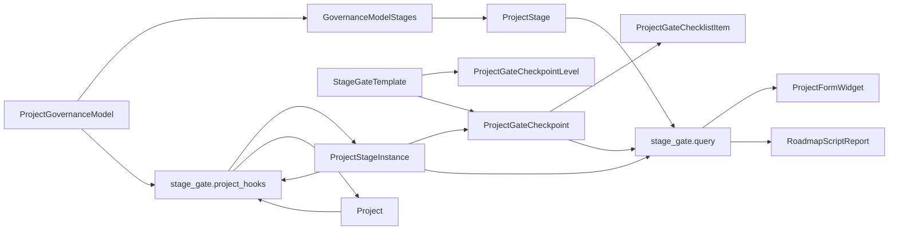

# Dinext Project Stage Gate

## 📖 Обзор

`dinext_project_stage_gate` добавляет отдельный слой управления по модели Stage-gate поверх стандартных записей ERPNext `Project`. Приложение сохраняет `Project` как основной бизнес-объект и вводит отдельные metadata- и transactional-DocType для реестра стадий, моделей управления, шаблонов gate, исполнения стадий, согласования checkpoint и дорожной карты.

Реализация намеренно независима от стандартного workflow `Project` и от подхода `Task Type = Stage/Phase`. Задачи, issues и существующие связи с портфелями по-прежнему можно использовать как связанные артефакты и evidence, но источником истины для управленческого продвижения проекта является доменная модель Stage-gate.

## ✨ Возможности

- Отдельные master-справочники для `Project Stage`, `Project Governance Model`, `Stage Gate Template` и `Project Gate Checkpoint Level`
- Transactional-слой исполнения через `Project Stage Instance`, `Project Gate Checkpoint` и `Project Gate Checklist Item`
- Whitelisted Python API для цепочки стадий проекта и данных roadmap-отчета
- Виджет на форме `Project`, подключаемый через `doctype_js`, без отдельного HTML custom field
- Автоматическое создание `Project Stage Instance` при назначении `Project Governance Model` проекту
- Автоматическое обновление полей `current_stage_instance`, `current_stage`, `stage_gate_status` и `current_gate_result` на `Project`
- Контролируемый сброс цепочки при смене или очистке `governance_model`: подтверждение на форме `Project`, отмена активных `Project Stage Instance` / `Project Gate Checkpoint` / строк чек-листа (статус `Canceled`), версионирование цепочки (`stage_chain_version`), скрытие архивных цепочек из виджета и roadmap
- Script Report дорожной карты Stage-gate с ленивой загрузкой ECharts
- Ролевая и permission-модель для `Stage Gate Owner`, `Stage Gate Reviewer`, `Stage Gate Approver` и `Project Governance Admin`
- Отдельный workflow checkpoint, не изменяющий существующий approval-flow `Project`

## 🚀 Установка

Установите приложение в существующий Frappe bench, где уже есть `erpnext` и `dinext_projects`:

```bash
cd /path/to/frappe-bench
bench get-app <repo-url> --branch develop
bench --site <site> install-app dinext_project_stage_gate
bench --site <site> migrate
```

Если вы применяете metadata-изменения в developer mode, убедитесь, что он включен на сайте до создания или обновления DocType:

```bash
bench --site <site> set-config developer_mode 1
```

После site-level metadata-изменений экспортируйте fixtures, чтобы состояние репозитория совпадало с базой данных:

```bash
bench --site <site> export-fixtures --app dinext_project_stage_gate
```

## 🛠️ Использование

### Назначение модели управления проекту

1. Создайте или обновите записи `Project Stage`.
2. Создайте записи `Project Gate Checkpoint Level` для нужных уровней согласования.
3. Создайте `Stage Gate Template`, связанные с `Project Gate Checkpoint Level`.
4. Соберите `Project Governance Model` с упорядоченными строками стадий; при необходимости укажите в каждой строке поле **Checkpoint Template** (ссылка на `Stage Gate Template`).
5. Назначьте модель управления документу `Project`.
6. Сохраните `Project`.

После сохранения серверный hook автоматически:

1. Загружает выбранный `Project Governance Model`.
2. Строит упорядоченную stage chain.
3. Создает записи `Project Stage Instance` с детерминированными именами: первая цепочка — `<PROJECT>-STAGE-001`, при повторном назначении модели после сброса — `<PROJECT>-SG<N>-STAGE-001` (N = `stage_chain_version` на `Project`).
4. Заполняет связи `previous_stage_instance` / `next_stage_instance`.
5. Обновляет summary-поля на `Project`.

Для каждой созданной `Project Stage Instance`, у которой в соответствующей строке модели управления задан **Checkpoint Template**, создаётся документ `Project Gate Checkpoint` с чек-листом, скопированным из шаблона (имя вида `<PROJECT>-STAGE-001-GATE`). Если шаблон в строке не указан, чекпоинт не создаётся.

Дальше форма `Project` использует whitelisted API для отрисовки уже сохраненной Stage-gate цепочки. Если модель управления не назначена, виджет не показывается.

Если цепочка уже создана, смена или очистка `governance_model` требует подтверждения в диалоге на форме `Project`. После подтверждения и сохранения текущая активная цепочка переводится в архив (все связанные исполнительные документы — в статус `Canceled`), номер активной версии цепочки на `Project` увеличивается; при назначенной новой модели создаётся новая цепочка, при пустой модели summary-поля проекта очищаются. Исторические строки остаются в БД, но не попадают в виджет и выборки roadmap для активной версии.

### Вызов API

Приложение предоставляет два основных whitelisted-метода:

```python
dinext_project_stage_gate.stage_gate.api.get_project_stage_chain(project)
dinext_project_stage_gate.stage_gate.api.get_roadmap_dataset(filters=None)
```

Вызов через bench:

```bash
bench --site <site> execute dinext_project_stage_gate.stage_gate.api.ping
bench --site <site> execute dinext_project_stage_gate.stage_gate.api.get_roadmap_dataset
```

## 📦 Технологии

- Python 3.10+
- Frappe Framework / ERPNext
- JavaScript form scripts и Script Reports
- ECharts для визуализации дорожной карты
- Ruff для Python linting
- Prettier / ESLint / pyupgrade через pre-commit tooling

## 🔧 Конфигурация

Основная конфигурация приложения находится в [`dinext_project_stage_gate/hooks.py`](dinext_project_stage_gate/hooks.py).

Ключевые настройки и точки интеграции:

- `required_apps = ["erpnext", "dinext_projects"]`
- `doctype_js = {"Project": "public/js/project_stage_gate_project.js"}`
- `doc_events["Project"]`:
  - `validate` требует флаг `confirm_governance_reset` при смене/очистке `governance_model`, если есть активная цепочка
  - `before_save` выполняет отмену активной цепочки и инкремент `stage_chain_version` при подтверждённом сбросе
  - `after_insert` и `on_update` синхронизируют stage chain и summary-поля
- `doc_events["Project Stage Instance"]`:
  - `on_update` и `on_trash` пересчитывают summary-поля проекта
- экспорт fixtures для:
  - `Role`
  - `Custom Field`
  - `Custom DocPerm`
  - `Workflow`
  - `Workflow Action Master`
  - `Workflow State`
  - `Report`

Приложение опирается на site metadata и export-fixtures, а не на переменные окружения.

## ✅ Требования

- Рабочий Frappe bench
- Установленные приложения:
  - `frappe`
  - `erpnext`
  - `dinext_projects`
- Доступ к запуску `bench --site <site> migrate`
- Включенный developer mode при создании/обновлении DocType или metadata в базе данных

## 🤝 Вклад в проект

Перед внесением изменений установите и включите `pre-commit`:

```bash
cd apps/dinext_project_stage_gate
pre-commit install
```

В репозитории используются:

- `ruff`
- `eslint`
- `prettier`
- `pyupgrade`

При изменении metadata-driven поведения придерживайтесь такого процесса:

1. Обновить код и metadata-файлы
2. Выполнить site migration
3. Запустить целевые тесты
4. Экспортировать fixtures

Проектные правила разработки находятся в [`AGENTS.md`](AGENTS.md).

## 📄 Документация

- [`README.md`](README.md) — обзор проекта на верхнем уровне
- [`AGENTS.md`](AGENTS.md) — проектная доктрина и правила работы с Frappe
- [`dinext_project_stage_gate/hooks.py`](dinext_project_stage_gate/hooks.py) — bootstrap приложения, fixtures и client script bindings
- [`dinext_project_stage_gate/stage_gate/api.py`](dinext_project_stage_gate/stage_gate/api.py) — whitelisted API
- [`dinext_project_stage_gate/stage_gate/project_hooks.py`](dinext_project_stage_gate/stage_gate/project_hooks.py) — orchestration layer для автоматического provisioning и пересчета summary
- [`dinext_project_stage_gate/stage_gate/query.py`](dinext_project_stage_gate/stage_gate/query.py) — read-model слой для виджета и отчета
- [`dinext_project_stage_gate/stage_gate/service.py`](dinext_project_stage_gate/stage_gate/service.py) — pure business logic для сборки stage chain и project summary
- [`dinext_project_stage_gate/dinext_project_stage_gate/doctype/project_stage_instance/test_project_stage_instance.py`](dinext_project_stage_gate/dinext_project_stage_gate/doctype/project_stage_instance/test_project_stage_instance.py) — integration-тесты автосоздания и guard-логики

## ❤️ Благодарности

- Frappe и ERPNext за metadata-driven платформу приложений
- `dinext_projects` за окружающий контекст проектов, портфелей и отчетности, с которым интегрируется это приложение

## 🗂️ Структура репозитория

```text
.
├── AGENTS.md
├── README.md
├── pyproject.toml
├── tests/
│   └── test_project_stage_gate_widget.test.js
└── dinext_project_stage_gate/
    ├── __init__.py
    ├── hooks.py
    ├── modules.txt
    ├── patches.txt
    ├── fixtures/
    │   ├── custom_docperm.json
    │   ├── custom_field.json
    │   ├── report.json
    │   ├── role.json
    │   ├── workflow.json
    │   ├── workflow_action_master.json
    │   └── workflow_state.json
    ├── public/
    │   ├── css/
    │   │   └── project_stage_gate.css
    │   └── js/
    │       ├── project_stage_gate_project.js
    │       └── vendor/
    │           └── echarts.min.js
    ├── stage_gate/
    │   ├── api.py
    │   ├── permissions.py
    │   ├── project_hooks.py
    │   ├── query.py
    │   ├── service.py
    │   └── validators.py
    ├── tests/
    │   ├── test_app_bootstrap.py
    │   ├── test_project_stage_gate_roadmap_report.py
    │   ├── test_stage_gate_api.py
    │   ├── test_stage_gate_permissions.py
    │   ├── test_stage_gate_query.py
    │   ├── test_stage_gate_service.py
    │   └── test_stage_gate_validators.py
    └── dinext_project_stage_gate/
        ├── doctype/
        │   ├── project_gate_checkpoint/
        │   ├── project_gate_checkpoint_level/
        │   ├── project_gate_checklist_item/
        │   ├── project_governance_model/
        │   ├── project_governance_model_stage/
        │   ├── project_stage/
        │   ├── project_stage_instance/
        │   ├── stage_gate_template/
        │   └── stage_gate_template_item/
        └── report/
            └── project_stage_gate_roadmap/
```

Пояснения к структуре:

- `dinext_project_stage_gate/dinext_project_stage_gate/doctype/` содержит metadata-backed определения DocType, контроллеры и тесты.
- `dinext_project_stage_gate/stage_gate/` содержит service/query/API и orchestration hooks для кросс-документной Stage-gate логики.
- `dinext_project_stage_gate/public/` содержит UI-ассеты формы `Project` и vendored ECharts stub.
- `dinext_project_stage_gate/fixtures/` хранит экспортированные metadata, необходимые для воспроизведения ролей, прав, workflow, отчетов и custom fields.
- `dinext_project_stage_gate/tests/` содержит точечные Python unit-тесты для service, query, API, permissions и report-поведения.
- `tests/` в корне репозитория содержит изолированный JavaScript regression-тест для поведения Project widget.

## 🔗 Схема потока



Основной runtime-поток выглядит так:

1. Metadata DocType определяют модель управления, реестр стадий, уровни checkpoint и шаблоны gate.
2. При сохранении `Project` hook-слой создает и синхронизирует `Project Stage Instance` и summary-поля проекта.
3. Изменения самих `Project Stage Instance` также пересчитывают summary проекта через `doc_events`.
4. `stage_gate.query` собирает read-optimized datasets для виджета проекта и roadmap-отчета.
5. Клиентский код отрисовывает Stage-gate цепочку на форме `Project` и roadmap chart в Script Report.

## Лицензия

`mit`
