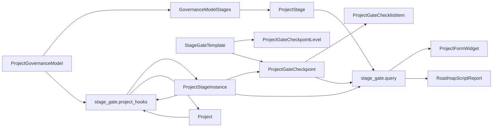

[Русский](README.ru.md)

# Dinext Project Stage Gate

## 📖 Overview

`dinext_project_stage_gate` adds a separate Stage-gate management layer on top of standard ERPNext `Project` records. The application retains `Project` as the main business object and introduces dedicated metadata and transactional DocTypes for the stage registry, governance models, gate templates, stage execution, checkpoint approval and roadmap.

The implementation is deliberately independent of the standard `Project` workflow and the `Task Type = Stage/Phase` approach. Tasks, issues and existing portfolio relationships can still be used as related artifacts and evidence, while the Stage-gate domain model is the source of truth for the project's governance progression.

## ✨ Features

- Separate master reference data for `Project Stage`, `Project Governance Model`, `Stage Gate Template` and `Project Gate Checkpoint Level`
- A transactional execution layer through `Project Stage Instance`, `Project Gate Checkpoint` and `Project Gate Checklist Item`
- Whitelisted Python API for the project's stage chain and roadmap report data
- A widget on the `Project` form, included through `doctype_js`, without a separate HTML custom field
- An AG Grid project table on the `Project Portfolio` form: RAG statuses, work effort, P&L, milestones, adding projects to and removing them from a portfolio; aggregate effort matches the Total footer on the project's Work Effort card (monthly aggregation)
- An `is_overdue` field on `Project Stage Instance` and `Project Gate Checkpoint`, recalculated daily, with overdue highlighting on the roadmap
- Report shortcuts in the **View** menu of the `Project Portfolio` form and the AG Grid toolbar (with Espresso icons): **Projects Stage Roadmap** (`portfolio` filter), **Consolidated Project P&L** (the `Project Budget Plan vs Forecast` report when `dinext_projects_pl` is installed), otherwise the standard **Profit and Loss Statement** (`project` filter containing portfolio projects)
- Automatic creation of `Project Stage Instance` records when a project is assigned a `Project Governance Model`
- Automatic creation of `Project Gate Checkpoint` from the `Checkpoint Template` specified in the governance model row
- Automatic updates of `current_stage_instance`, `current_stage`, `stage_gate_status` and `current_gate_result` on `Project`
- Automatic calculation of `Project Stage Instance` `planned_start_date` / `planned_end_date` from `expected_start_date`, `expected_duration_days` and working days in the project / company holiday list
- Controlled chain reset when `governance_model` changes or is cleared: confirmation on the `Project` form, cancellation of active `Project Stage Instance` / `Project Gate Checkpoint` / checklist rows (`Canceled` status), chain versioning (`stage_chain_version`), and exclusion of archived chains from the widget and roadmap
- A Stage-gate roadmap Script Report with lazy-loaded ECharts
- A role and permission model for `Stage Gate Owner`, `Stage Gate Reviewer`, `Stage Gate Approver` and `Project Governance Admin`
- A separate checkpoint workflow that leaves the existing `Project` approval flow unchanged
- On the `Project Gate Checkpoint` form, checklist rows marked **Is Mandatory** cannot be deleted until the flag is cleared; the checklist table's **Delete All Rows** bulk-delete button is hidden (see `project_gate_checkpoint.js`)
- On every `Project Gate Checkpoint` save, the server recalculates the hidden **Checklist Completed** field (`checklist_completed`): it is checked only when every checklist row is **Done** or **Canceled**; otherwise it is cleared (including when an item returns to **Open**). The fixture workflow uses this field as a condition for the **Submit for Review** transition (Draft → In Review)

## 🚀 Installation

Install the application into an existing Administrator that already has `erpnext` and `dinext_projects`:

```bash
cd /path/to/frappe-bench
bench get-app <repo-url> --branch develop
bench --site <site> install-app dinext_project_stage_gate
bench --site <site> migrate
```

If you apply metadata changes in developer mode, make sure it is enabled on the site before creating or updating DocTypes:

```bash
bench --site <site> set-config developer_mode 1
```

After site-level metadata changes, export fixtures so the repository state matches the database:

```bash
bench --site <site> export-fixtures --app dinext_project_stage_gate
```

## 🛠️ Usage

### Assigning a governance model to a project

1. Create or update `Project Stage` records.
2. Create `Project Gate Checkpoint Level` records for the required approval levels.
3. Create `Stage Gate Template` records linked to `Project Gate Checkpoint Level`.
4. Assemble a `Project Governance Model` with ordered stage rows; specify the **Checkpoint Template** field (a link to `Stage Gate Template`) in each row as necessary.
5. Assign the governance model to a `Project` document.
6. Save `Project`.

After saving, the server hook automatically:

1. Loads the selected `Project Governance Model`.
2. Builds the ordered stage chain.
3. Creates `Project Stage Instance` records with deterministic names: `<PROJECT>-STAGE-001` for the first chain, or `<PROJECT>-SG<N>-STAGE-001` when a model is reassigned after a reset (N = `stage_chain_version` on `Project`).
4. Populates the `previous_stage_instance` / `next_stage_instance` links.
5. Updates the summary fields on `Project`.

For each created `Project Stage Instance` whose corresponding governance model row specifies a **Checkpoint Template**, a `Project Gate Checkpoint` document is created with a checklist copied from the template (a name such as `<PROJECT>-STAGE-001-GATE`). If the row has no template, no checkpoint is created. If the template is disabled or contains no checklist items, chain creation stops with a validation error.

Planned `Project Stage Instance` dates are calculated automatically:

1. The first stage's `planned_start_date` comes from `Project.expected_start_date` (or `today()`), then shifts to the nearest working day.
2. Subsequent stages start on the nearest working day after the previous stage's `planned_end_date`.
3. `planned_end_date` is calculated from the governance model row's `expected_duration_days`, using the project or company holiday list.
4. When a stage moves to `Active` or `Completed`, the document automatically sets `actual_start_date`; on `Completed`, it also fills `actual_end_date` if those dates were not set manually.

When editing the checklist on a `Project Gate Checkpoint` form, deleting a row with **Is Mandatory** checked is blocked on the client until the flag is cleared; after clearing it, the row can be deleted and the document saved in a single save operation. Bulk deletion of all table rows is unavailable (the button is hidden), preventing this check from being bypassed.

Checklist row statuses (**Open**, **Done**, **Canceled**) are defined in `Project Gate Checklist Item`. After a checkpoint is saved, **Checklist Completed** is updated in the [`project_gate_checkpoint.py`](dinext_project_stage_gate/dinext_project_stage_gate/doctype/project_gate_checkpoint/project_gate_checkpoint.py) controller: it is true only when every row has a terminal status (**Done** or **Canceled**). The `doc.checklist_completed` condition in [`fixtures/workflow.json`](dinext_project_stage_gate/fixtures/workflow.json) permits the **Submit for Review** workflow action only when the entire checklist is closed.

The `Project` form then uses the whitelisted API to render the saved Stage-gate chain. If no governance model is assigned, the widget is not shown.

For a saved portfolio, the `Project Portfolio` form provides **View** menu items and matching table toolbar buttons (a shared `get_view_actions` registry in [`project_portfolio_stage_gate.js`](dinext_project_stage_gate/public/js/project_portfolio_stage_gate.js)):

| Action | Condition | Report / destination | Filter |
|----------|---------|-----------------|--------|
| Projects Stage Roadmap | report permission | `Project Stage Gate Roadmap` | `portfolio` = current portfolio |
| P&L (dinext) | `dinext_projects_pl` installed and report permission | **Consolidated Project P&L** → `Project Budget Plan vs Forecast` | `project_portfolio` = current portfolio |
| P&L (fallback) | `dinext_projects_pl` **not** installed and report permission | `Profit and Loss Statement` | `project` = portfolio project list (`custom_project_portfolio`) |

The client detects `dinext_projects_pl` installation through `frappe.boot.versions.dinext_projects_pl` (the server in [`portfolio_grid.py`](dinext_project_stage_gate/stage_gate/portfolio_grid.py) uses the same app identifier for the table's P&L summary). Report access is checked through `frappe.boot.user.all_reports`.

### Project table on the Project Portfolio form

For a saved portfolio (not a new record), an AG Grid project table is rendered in the `custom_portfolio_projects` HTML field (`custom_projects` section). The table is included through `doctype_js` and uses [`DinextAgGrid`](../dinext_common/dinext_common/public/js/ag-grid/bootstrap.js) (AG Grid v35, `theme: "legacy"` for CSS theming).

Table features:

1. Summary data for each project: type, priority, RAG statuses, active stage, customer, department, work effort, P&L and upcoming open milestones.
2. A left-pinned `Project` column with the project name and code; Stage-gate status is available in the hover tooltip.
3. A toolbar above the table: **Add** / **Remove** (icons `es-line-add` / `es-line-delete`, styled like a Frappe child table footer), then a separator and the **View** menu buttons (roadmap and P&L report).
4. Linking and unlinking projects through `custom_project_portfolio` on `Project` (add dialog, confirmation when removing selected rows).
5. Automatic synchronization of AG Grid's light/dark theme with Frappe Desk (`data-theme` / `data-theme-mode`).
6. Compact layout: dense rows and headers, minimal cell padding.

The read model and mutations are implemented in [`stage_gate/portfolio_grid.py`](dinext_project_stage_gate/stage_gate/portfolio_grid.py) and exposed through the whitelisted API (see API calls).

#### Work effort (Labor)

The aggregate `labor_plan_total`, `labor_forecast_total`, `labor_plan_today` and `labor_actual_total` columns are calculated on the server and displayed in AG Grid without additional client logic.

**Data sources**

| Field | Source |
|------|----------|
| Plan / Forecast | `Project Work Efforts` + `Project Work Efforts Amount` (plan and expectation by task, role and month) |
| Actual | approved `User Timesheet Position` records with `document_type = Task` (hours through the current date) |

**Period window** — calendar months from `Project.expected_start_date` to `Project.expected_end_date` (reasonable defaults are used if dates are absent).

**Task tree** — as on the project's Work Effort card: only tasks without the `is_milestone` flag, traversed downwards from roots (empty `parent_task`) using BFS; orphan tasks with unreachable parents are not promoted to roots.

**Plan Total and Forecast Total** — the sum of monthly column totals (equivalent to `calc_we_column_total` in the Work Effort client script):

1. Roles come from `Project Team Details.pt_role`; if no team is defined, use roles found in PWE.
2. For each month in the window, each role and each root task:
   - if the task has a plan (or forecast) > 0 in **that month**, use the task's value;
   - otherwise, recursively sum child tasks **for that month only**.
3. The project total is the sum of those monthly columns.

These semantics match the Total footer on the project form, rather than the window aggregate from the disabled `Project_Work_Efforts V5` (where a parent's plan in any month of the window blocked every child month).

**Plan Today** — how many planned hours should be completed by today:

```
Plan Today = Σ (month_plan × month_progress_factor)
```

where `month_plan` is the same monthly plan used for Plan Total, and the factor is:

- **past months** — `1.0` (the entire month's plan);
- **current month** — `day / number of days in the month` (linear proration);
- **future months** — `0.0`.

Forecast and Actual do not contribute to Plan Today. Labor fields are rounded to one decimal place.

#### P&L

When `dinext_projects_pl` is installed, the summary is built from `Project Budget` / `Project Budget Amount` / `Project Budget Dimension`: Plan Total, Plan Today and Forecast Total are calculated monthly, accounting for the `Account` hierarchy, task/dimension buckets and the project card rollup rules in `dinext_projects_pl` (parent's own data wins; otherwise sum children). Actuals come from `GL Entry`, respecting `Account.root_type` (Income/Expense); balance sheet accounts (Liability, etc.) are excluded. Without `dinext_projects_pl`, the Actual column falls back to `Project.gross_margin`. P&L columns: Plan Total, Plan Today, Actual, Forecast Total.

#### Overdue stages and checkpoints

The `is_overdue` field on `Project Stage Instance` and `Project Gate Checkpoint` is recalculated:

- on every document save (the DocType controller's `validate` method);
- daily by the scheduler (`dinext_project_stage_gate.tasks.daily` → `sync_overdue_flags`).

Rules:

- **stage** — overdue if its status is `Planned` and `planned_start_date` is in the past, or if `planned_end_date` is in the past (except statuses `Completed`, `Canceled`, `Skipped`);
- **checkpoint** — overdue if `gate_due_date` is in the past (except `Approved`, `Canceled`, `Skipped`).

Overdue stages and gates are outlined in red on the roadmap report.

Table styles: [`public/css/project_portfolio_grid.css`](dinext_project_stage_gate/public/css/project_portfolio_grid.css).

After changing frontend assets, run:

```bash
bench build --app dinext_project_stage_gate
bench --site <site> clear-cache
```

If the chain already exists, changing or clearing `governance_model` requires confirmation in a dialog on the `Project` form. After confirmation and saving, the current active chain is archived (all related execution documents move to `Canceled`), and the active chain version on `Project` is incremented; a new model creates a new chain, while an empty model clears the project's summary fields. Historical rows remain in the database but are excluded from the widget and roadmap queries for the active version.

### API calls

The application provides whitelisted methods for the stage chain, roadmap and portfolio table:

```python
dinext_project_stage_gate.stage_gate.api.get_project_stage_chain(project)
dinext_project_stage_gate.stage_gate.api.get_roadmap_dataset(filters=None)

# Project Portfolio grid
dinext_project_stage_gate.stage_gate.api.get_portfolio_project_grid(portfolio)
dinext_project_stage_gate.stage_gate.api.get_unassigned_projects()
dinext_project_stage_gate.stage_gate.api.add_projects_to_portfolio(portfolio, projects)
dinext_project_stage_gate.stage_gate.api.remove_projects_from_portfolio(portfolio, projects)
```

Calling through bench:

```bash
bench --site <site> execute dinext_project_stage_gate.stage_gate.api.ping
bench --site <site> execute dinext_project_stage_gate.stage_gate.api.get_roadmap_dataset
```

## 📦 Technologies

- Python 3.10+
- Frappe Framework / ERPNext
- JavaScript form scripts and Script Reports
- AG Grid (through `dinext_common`) for the project table on the `Project Portfolio` form
- ECharts for roadmap visualization
- Node.js built-in test runner for isolated JS regression tests
- Ruff for Python linting
- Prettier / ESLint / pyupgrade through pre-commit tooling

## 🔧 Configuration

The main application configuration is in [`dinext_project_stage_gate/hooks.py`](dinext_project_stage_gate/hooks.py).

Key settings and integration points:

- `required_apps = ["erpnext", "dinext_projects"]`
- `doctype_js`:
  - `Project -> public/js/project_stage_gate_project.js`
  - `Project Portfolio -> public/js/project_portfolio_stage_gate.js`
- `doc_events["Project"]`:
  - `validate` requires the `confirm_governance_reset` flag when `governance_model` changes/is cleared if an active chain exists
  - `before_save` cancels the active chain and increments `stage_chain_version` on a confirmed reset
  - `after_insert` and `on_update` synchronize the stage chain and summary fields
- `doc_events["Project Stage Instance"]`:
  - `on_update` and `on_trash` recalculate the project's summary fields
- The `Project Stage Instance` and `Project Gate Checkpoint` controllers call `overdue_sync` for the `is_overdue` field in `validate`
- `scheduler_events["daily"]` — `dinext_project_stage_gate.tasks.daily` (bulk `is_overdue` recalculation)
- Fixture export for:
  - `Role`
  - `Custom Field`
  - `Custom DocPerm`
  - `Workflow`
  - `Workflow Action Master`
  - `Workflow State`
  - `Report`

The application relies on site metadata and export-fixtures rather than environment variables.

## ✅ Requirements

- A working Administrator
- Installed applications:
  - `frappe`
  - `erpnext`
  - `dinext_projects`
  - `dinext_common` (AG Grid bootstrap for the portfolio table)
  - `dinext_projects_pl` (optional — full P&L summary in the portfolio table)
- Access to run `bench --site <site> migrate`
- Developer mode enabled when creating/updating DocTypes or metadata in the database

## 🤝 Contributing

Before making changes, install and enable `pre-commit`:

```bash
cd apps/dinext_project_stage_gate
pre-commit install
```

The repository uses:

- `ruff`
- `eslint`
- `prettier`
- `pyupgrade`

Minimum checks before publishing changes:

```bash
bench run-tests --app dinext_project_stage_gate
node --test tests/*.js
```

Follow this process when changing metadata-driven behavior:

1. Update code and metadata files
2. Run site migration
3. Run targeted tests
4. Export fixtures

Project development rules are in [`AGENTS.md`](AGENTS.md).

## 📄 Documentation

- [`README.md`](README.md) — high-level project overview
- [`AGENTS.md`](AGENTS.md) — project doctrine and Frappe working rules
- [`dinext_project_stage_gate/hooks.py`](dinext_project_stage_gate/hooks.py) — application bootstrap, fixtures and client script bindings
- [`dinext_project_stage_gate/stage_gate/api.py`](dinext_project_stage_gate/stage_gate/api.py) — whitelisted API
- [`dinext_project_stage_gate/stage_gate/checkpoint_provision.py`](dinext_project_stage_gate/stage_gate/checkpoint_provision.py) — checkpoint creation from a template on `Project Stage Instance` insertion
- [`dinext_project_stage_gate/stage_gate/project_hooks.py`](dinext_project_stage_gate/stage_gate/project_hooks.py) — orchestration layer for automatic provisioning and summary recalculation
- [`dinext_project_stage_gate/stage_gate/query.py`](dinext_project_stage_gate/stage_gate/query.py) — read-model layer for the widget and report
- [`dinext_project_stage_gate/stage_gate/service.py`](dinext_project_stage_gate/stage_gate/service.py) — pure business logic for stage chain and project summary assembly
- [`dinext_project_stage_gate/stage_gate/working_days.py`](dinext_project_stage_gate/stage_gate/working_days.py) — stage working date calculation using the holiday list
- [`dinext_project_stage_gate/stage_gate/portfolio_grid.py`](dinext_project_stage_gate/stage_gate/portfolio_grid.py) — read model and mutations for AG Grid on the `Project Portfolio` form (work effort, P&L, milestones)
- [`dinext_project_stage_gate/stage_gate/overdue_sync.py`](dinext_project_stage_gate/stage_gate/overdue_sync.py) — calculation and bulk synchronization of `is_overdue` for stages and checkpoints
- [`dinext_project_stage_gate/tasks.py`](dinext_project_stage_gate/tasks.py) — daily scheduler hook for `sync_overdue_flags`
- [`dinext_project_stage_gate/dinext_project_stage_gate/doctype/project_gate_checkpoint/project_gate_checkpoint.js`](dinext_project_stage_gate/dinext_project_stage_gate/doctype/project_gate_checkpoint/project_gate_checkpoint.js) — client checklist logic (mandatory row deletion, hiding Delete All Rows)
- [`dinext_project_stage_gate/dinext_project_stage_gate/doctype/project_gate_checkpoint/project_gate_checkpoint.py`](dinext_project_stage_gate/dinext_project_stage_gate/doctype/project_gate_checkpoint/project_gate_checkpoint.py) — validation and synchronization of `checklist_completed` with the checklist
- [`dinext_project_stage_gate/dinext_project_stage_gate/doctype/project_stage_instance/project_stage_instance.py`](dinext_project_stage_gate/dinext_project_stage_gate/doctype/project_stage_instance/project_stage_instance.py) — planned/actual date calculation and gate checkpoint provisioning in `after_insert`
- [`dinext_project_stage_gate/public/js/project_portfolio_stage_gate.js`](dinext_project_stage_gate/public/js/project_portfolio_stage_gate.js) — AG Grid on the `Project Portfolio` form, toolbar, View action registry (roadmap, P&L reports)
- [`dinext_project_stage_gate/public/css/project_portfolio_grid.css`](dinext_project_stage_gate/public/css/project_portfolio_grid.css) — portfolio table styles (Frappe theme + compact layout)
- [`dinext_project_stage_gate/dinext_project_stage_gate/doctype/project_gate_checkpoint/test_project_gate_checkpoint.py`](dinext_project_stage_gate/dinext_project_stage_gate/doctype/project_gate_checkpoint/test_project_gate_checkpoint.py) — `checklist_completed` recalculation tests
- [`dinext_project_stage_gate/dinext_project_stage_gate/doctype/project_stage_instance/test_project_stage_instance.py`](dinext_project_stage_gate/dinext_project_stage_gate/doctype/project_stage_instance/test_project_stage_instance.py) — automatic creation and guard logic integration tests
- [`dinext_project_stage_gate/tests/test_portfolio_grid.py`](dinext_project_stage_gate/tests/test_portfolio_grid.py) — portfolio read-model Python tests (work effort, task tree, link/unlink)
- [`dinext_project_stage_gate/tests/test_stage_gate_overdue_sync.py`](dinext_project_stage_gate/tests/test_stage_gate_overdue_sync.py) — `is_overdue` recalculation and daily synchronization tests
- [`tests/test_project_portfolio_stage_gate.test.js`](tests/test_project_portfolio_stage_gate.test.js) — AG Grid, toolbar/View actions, P&L navigation, theme and `Project Portfolio` integration JS regression test
- [`tests/test_project_gate_checkpoint_form.test.js`](tests/test_project_gate_checkpoint_form.test.js) — client checklist restrictions JS regression test
- [`tests/test_project_stage_gate_widget.test.js`](tests/test_project_stage_gate_widget.test.js) — `Project` widget JS regression test
- [`tests/test_project_stage_gate_roadmap.test.js`](tests/test_project_stage_gate_roadmap.test.js) — roadmap report JS regression test

## 🗂️ Repository structure

```text
.
├── AGENTS.md
├── README.md
├── pyproject.toml
├── tests/
│   ├── test_project_gate_checkpoint_form.test.js
│   ├── test_project_portfolio_stage_gate.test.js
│   ├── test_project_stage_gate_roadmap.test.js
│   └── test_project_stage_gate_widget.test.js
└── dinext_project_stage_gate/
    ├── __init__.py
    ├── hooks.py
    ├── tasks.py
    ├── modules.txt
    ├── patches.txt
    ├── fixtures/
    │   ├── custom_docperm.json
    │   ├── custom_field.json
    │   ├── report.json
    │   ├── role.json
    │   ├── workflow.json
    │   ├── workflow_action_master.json
    │   └── workflow_state.json
    ├── public/
    │   ├── css/
    │   │   ├── project_portfolio_grid.css
    │   │   └── project_stage_gate.css
    │   └── js/
    │       ├── project_portfolio_stage_gate.js
    │       ├── project_stage_gate_project.js
    │       └── vendor/
    │           └── echarts.min.js
    ├── stage_gate/
    │   ├── api.py
    │   ├── checkpoint_provision.py
    │   ├── overdue_sync.py
    │   ├── permissions.py
    │   ├── portfolio_grid.py
    │   ├── project_hooks.py
    │   ├── query.py
    │   ├── service.py
    │   ├── validators.py
    │   └── working_days.py
    ├── tests/
    │   ├── test_app_bootstrap.py
    │   ├── test_portfolio_grid.py
    │   ├── test_stage_gate_overdue_sync.py
    │   ├── test_project_stage_gate_roadmap_report.py
    │   ├── test_stage_gate_api.py
    │   ├── test_stage_gate_permissions.py
    │   ├── test_stage_gate_query.py
    │   ├── test_stage_gate_service.py
    │   └── test_stage_gate_validators.py
    └── dinext_project_stage_gate/
        ├── doctype/
        │   ├── project_gate_checkpoint/
        │   ├── project_gate_checkpoint_level/
        │   ├── project_gate_checklist_item/
        │   ├── project_governance_model/
        │   ├── project_governance_model_stage/
        │   ├── project_stage/
        │   ├── project_stage_instance/
        │   ├── stage_gate_template/
        │   └── stage_gate_template_item/
        └── report/
            └── project_stage_gate_roadmap/
```

Structure notes:

- `dinext_project_stage_gate/dinext_project_stage_gate/doctype/` contains metadata-backed DocType definitions, controllers and tests.
- `dinext_project_stage_gate/stage_gate/` contains service/query/API, orchestration hooks, checkpoint provisioning and working date utilities.
- `dinext_project_stage_gate/public/` contains `Project` form UI assets, AG Grid and styles for `Project Portfolio`, and a vendored ECharts stub.
- `dinext_project_stage_gate/fixtures/` stores exported metadata needed to reproduce roles, permissions, workflows, reports and custom fields.
- `dinext_project_stage_gate/tests/` contains focused Python unit tests for service, query, API, permissions and report behavior.
- Root-level `tests/` contains isolated JavaScript regression tests for the `Project` widget, `Project Portfolio` form, `Project Gate Checkpoint` client logic and roadmap report.

## 🔗 Flow diagram



The main runtime flow is:

1. Metadata DocTypes define the governance model, stage registry, checkpoint levels and gate ExampleCustomer08.
2. When `Project` is saved, the hook layer creates and synchronizes `Project Stage Instance`, and the stage controller calculates planned dates from the working calendar.
3. After `Project Stage Instance` insertion, the provisioning module creates `Project Gate Checkpoint` if the stage has a template.
4. Changes to `Project Stage Instance` records also recalculate the project summary through `doc_events`.
5. `stage_gate.query` assembles read-optimized datasets for the project widget and roadmap report.
6. Client code renders the Stage-gate chain on the `Project` form and the project AG Grid on the `Project Portfolio` form (toolbar + View menu report shortcuts), and builds the roadmap chart in the Script Report.
7. Saving `Project Gate Checkpoint` recalculates `checklist_completed` from checklist row statuses; the checkpoint workflow uses this field to permit submission for review.
8. Stage and checkpoint controllers on save, plus the daily scheduler, keep `is_overdue` current for the roadmap and reporting.
9. The portfolio AG Grid requests aggregate work effort and P&L through `portfolio_grid.get_portfolio_project_rows`, using monthly PWE aggregation compatible with the project's Work Effort card.

## License

GNU GPL v3. See [license.txt](license.txt) for the license text.
