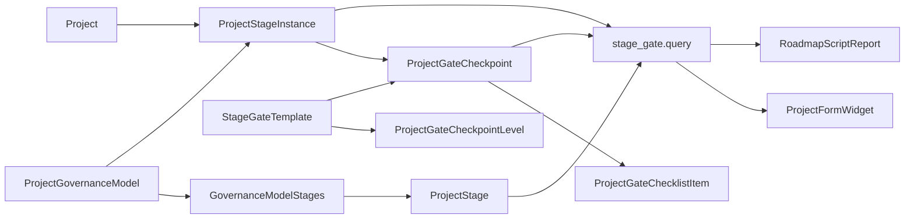

# Dinext Project Stage Gate

## 📖 Обзор

`dinext_project_stage_gate` добавляет отдельный слой управления по модели Stage-gate поверх стандартных записей ERPNext `Project`. Приложение сохраняет `Project` как основной бизнес-объект и вводит отдельные metadata- и transactional-DocType для реестра стадий, моделей управления, шаблонов gate, исполнения стадий, согласования checkpoint и дорожной карты.

Реализация намеренно независима от стандартного workflow `Project` и от подхода `Task Type = Stage/Phase`. Задачи, issues и существующие связи с портфелями по-прежнему можно использовать как связанные артефакты и evidence, но источником истины для управленческого продвижения проекта является доменная модель Stage-gate.

## ✨ Возможности

- Отдельные master-справочники для `Project Stage`, `Project Governance Model`, `Stage Gate Template` и `Project Gate Checkpoint Level`
- Transactional-слой исполнения через `Project Stage Instance`, `Project Gate Checkpoint` и `Project Gate Checklist Item`
- Whitelisted Python API для цепочки стадий проекта и данных roadmap-отчета
- Виджет на форме `Project`, подключаемый через `doctype_js`, без отдельного HTML custom field
- Script Report дорожной карты Stage-gate с ленивой загрузкой ECharts
- Ролевая и permission-модель для `Stage Gate Owner`, `Stage Gate Reviewer`, `Stage Gate Approver` и `Project Governance Admin`
- Отдельный workflow checkpoint, не изменяющий существующий approval-flow `Project`
- Utility для backfill старых naming-полей и уровней checkpoint в текущую каноническую модель

## 🚀 Установка

Установите приложение в существующий Administrator, где уже есть `erpnext` и `dinext_projects`:

```bash
cd /path/to/frappe-bench
bench get-app <repo-url> --branch develop
bench --site <site> install-app dinext_project_stage_gate
bench --site <site> migrate
```

Если вы применяете metadata-изменения в developer mode, убедитесь, что он включен на сайте до создания или обновления DocType:

```bash
bench --site <site> set-config developer_mode 1
```

После site-level metadata-изменений экспортируйте fixtures, чтобы состояние репозитория совпадало с базой данных:

```bash
bench --site <site> export-fixtures --app dinext_project_stage_gate
```

## 🛠️ Использование

### Назначение модели управления проекту

1. Создайте или обновите записи `Project Stage`.
2. Создайте записи `Project Gate Checkpoint Level` для нужных уровней согласования.
3. Соберите `Project Governance Model` с упорядоченными строками стадий.
4. Создайте `Stage Gate Template`, связанные с `Project Gate Checkpoint Level`.
5. Назначьте модель управления документу `Project`.

После этого форма `Project` использует whitelisted API для отрисовки Stage-gate цепочки. Если модель управления не назначена, виджет не показывается.

### Вызов API

Приложение предоставляет два основных whitelisted-метода:

```python
dinext_project_stage_gate.stage_gate.api.get_project_stage_chain(project)
dinext_project_stage_gate.stage_gate.api.get_roadmap_dataset(filters=None)
```

Вызов через bench:

```bash
bench --site <site> execute dinext_project_stage_gate.stage_gate.api.ping
bench --site <site> execute dinext_project_stage_gate.stage_gate.api.get_roadmap_dataset
```

### Запуск utility для backfill Stage-gate

Этот utility создает уровни checkpoint по умолчанию и переносит старые naming-поля и данные уровней checkpoint в текущую модель:

```bash
bench --site <site> execute \
  dinext_project_stage_gate.stage_gate.backfill.backfill_checkpoint_levels_and_names
```

## 📦 Технологии

- Python 3.10+
- Frappe Framework / ERPNext
- JavaScript form scripts и Script Reports
- ECharts для визуализации дорожной карты
- Ruff для Python linting
- Prettier / ESLint / pyupgrade через pre-commit tooling

## 🔧 Конфигурация

Основная конфигурация приложения находится в [`dinext_project_stage_gate/hooks.py`](dinext_project_stage_gate/hooks.py).

Ключевые настройки и точки интеграции:

- `required_apps = ["erpnext", "dinext_projects"]`
- `doctype_js = {"Project": "public/js/project_stage_gate_project.js"}`
- экспорт fixtures для:
  - `Role`
  - `Custom Field`
  - `Custom DocPerm`
  - `Workflow`
  - `Workflow Action Master`
  - `Workflow State`
  - `Report`

Приложение опирается на site metadata и export-fixtures, а не на переменные окружения.

## ✅ Требования

- Рабочий Administrator
- Установленные приложения:
  - `frappe`
  - `erpnext`
  - `dinext_projects`
- Доступ к запуску `bench --site <site> migrate`
- Включенный developer mode при создании/обновлении DocType или metadata в базе данных

## 🤝 Вклад в проект

Перед внесением изменений установите и включите `pre-commit`:

```bash
cd apps/dinext_project_stage_gate
pre-commit install
```

В репозитории используются:

- `ruff`
- `eslint`
- `prettier`
- `pyupgrade`

При изменении metadata-driven поведения придерживайтесь такого процесса:

1. Обновить код и metadata-файлы
2. Выполнить site migration
3. Запустить целевые тесты
4. Экспортировать fixtures

Проектные правила разработки находятся в [`AGENTS.md`](AGENTS.md).

## 📄 Документация

- [`README.md`](README.md) — обзор проекта на верхнем уровне
- [`AGENTS.md`](AGENTS.md) — проектная доктрина и правила работы с Frappe
- [`dinext_project_stage_gate/hooks.py`](dinext_project_stage_gate/hooks.py) — bootstrap приложения, fixtures и client script bindings
- [`dinext_project_stage_gate/stage_gate/api.py`](dinext_project_stage_gate/stage_gate/api.py) — whitelisted API
- [`dinext_project_stage_gate/stage_gate/query.py`](dinext_project_stage_gate/stage_gate/query.py) — read-model слой для виджета и отчета
- [`dinext_project_stage_gate/stage_gate/backfill.py`](dinext_project_stage_gate/stage_gate/backfill.py) — helper для миграции канонических имен и checkpoint levels

## ❤️ Благодарности

- Frappe и ERPNext за metadata-driven платформу приложений
- `dinext_projects` за окружающий контекст проектов, портфелей и отчетности, с которым интегрируется это приложение

## 🗂️ Структура репозитория

```text
.
├── AGENTS.md
├── README.md
├── pyproject.toml
├── tests/
│   └── test_project_stage_gate_widget.test.js
└── dinext_project_stage_gate/
    ├── __init__.py
    ├── hooks.py
    ├── modules.txt
    ├── patches.txt
    ├── fixtures/
    │   ├── custom_docperm.json
    │   ├── custom_field.json
    │   ├── report.json
    │   ├── role.json
    │   ├── workflow.json
    │   ├── workflow_action_master.json
    │   └── workflow_state.json
    ├── public/
    │   ├── css/
    │   │   └── project_stage_gate.css
    │   └── js/
    │       ├── project_stage_gate_project.js
    │       └── vendor/
    │           └── echarts.min.js
    ├── stage_gate/
    │   ├── api.py
    │   ├── backfill.py
    │   ├── permissions.py
    │   ├── query.py
    │   ├── service.py
    │   └── validators.py
    ├── tests/
    │   ├── test_app_bootstrap.py
    │   ├── test_project_stage_gate_roadmap_report.py
    │   ├── test_stage_gate_api.py
    │   ├── test_stage_gate_permissions.py
    │   ├── test_stage_gate_query.py
    │   ├── test_stage_gate_service.py
    │   └── test_stage_gate_validators.py
    └── dinext_project_stage_gate/
        ├── doctype/
        │   ├── project_gate_checkpoint/
        │   ├── project_gate_checkpoint_level/
        │   ├── project_gate_checklist_item/
        │   ├── project_governance_model/
        │   ├── project_governance_model_stage/
        │   ├── project_stage/
        │   ├── project_stage_instance/
        │   ├── stage_gate_template/
        │   └── stage_gate_template_item/
        └── report/
            └── project_stage_gate_roadmap/
```

Пояснения к структуре:

- `dinext_project_stage_gate/dinext_project_stage_gate/doctype/` содержит metadata-backed определения DocType, контроллеры и тесты.
- `dinext_project_stage_gate/stage_gate/` содержит тонкий Python-слой service/query/API для кросс-документной логики.
- `dinext_project_stage_gate/public/` содержит UI-ассеты формы `Project` и vendored ECharts stub.
- `dinext_project_stage_gate/fixtures/` хранит экспортированные metadata, необходимые для воспроизведения ролей, прав, workflow, отчетов и custom fields.
- `dinext_project_stage_gate/tests/` содержит точечные Python unit-тесты для service, query, API, permissions и report-поведения.
- `tests/` в корне репозитория содержит изолированный JavaScript regression-тест для поведения Project widget.

## 🔗 Схема потока



Основной runtime-поток выглядит так:

1. Metadata DocType определяют модель управления, реестр стадий, уровни checkpoint и ExampleCustomer08 gate.
2. Проекты ссылаются на модели управления и накапливают transactional stage instances и checkpoints.
3. `stage_gate.query` собирает read-optimized datasets для виджета проекта и roadmap-отчета.
4. Клиентский код отрисовывает Stage-gate цепочку на форме `Project` и roadmap chart в Script Report.

## Лицензия

`mit`
