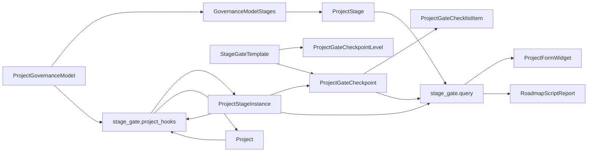

# Dinext Project Stage Gate

## 📖 Обзор

`dinext_project_stage_gate` добавляет отдельный слой управления по модели Stage-gate поверх стандартных записей ERPNext `Project`. Приложение сохраняет `Project` как основной бизнес-объект и вводит отдельные metadata- и transactional-DocType для реестра стадий, моделей управления, шаблонов gate, исполнения стадий, согласования checkpoint и дорожной карты.

Реализация намеренно независима от стандартного workflow `Project` и от подхода `Task Type = Stage/Phase`. Задачи, issues и существующие связи с портфелями по-прежнему можно использовать как связанные артефакты и evidence, но источником истины для управленческого продвижения проекта является доменная модель Stage-gate.

## ✨ Возможности

- Отдельные master-справочники для `Project Stage`, `Project Governance Model`, `Stage Gate Template` и `Project Gate Checkpoint Level`
- Transactional-слой исполнения через `Project Stage Instance`, `Project Gate Checkpoint` и `Project Gate Checklist Item`
- Whitelisted Python API для цепочки стадий проекта и данных roadmap-отчета
- Виджет на форме `Project`, подключаемый через `doctype_js`, без отдельного HTML custom field
- AG Grid-таблица проектов на форме `Project Portfolio`: статусы RAG, трудозатраты, P&L, вехи, добавление и удаление проектов из портфеля; сводные трудозатраты совпадают с footer «Итого» на карточке «Трудозатраты» проекта (помесячная агрегация)
- Поле `is_overdue` на `Project Stage Instance` и `Project Gate Checkpoint` с ежедневным пересчётом и подсветкой просрочки на roadmap
- Кнопки перехода к отчётам в меню **View** формы `Project Portfolio` и в toolbar AG Grid-таблицы (с иконками Espresso): **Projects Stage Roadmap** (фильтр `portfolio`), **Сводный P&L по проектам** (отчёт `Project Budget Plan vs Forecast` при установленном `dinext_projects_pl`), иначе стандартный **Profit and Loss Statement** (фильтр `project` по проектам портфеля)
- Автоматическое создание `Project Stage Instance` при назначении `Project Governance Model` проекту
- Автоматическое создание `Project Gate Checkpoint` из `Checkpoint Template`, указанного в строке модели управления
- Автоматическое обновление полей `current_stage_instance`, `current_stage`, `stage_gate_status` и `current_gate_result` на `Project`
- Автоматический расчет `planned_start_date` / `planned_end_date` у `Project Stage Instance` по `expected_start_date`, `expected_duration_days` и рабочим дням из holiday list проекта / компании
- Контролируемый сброс цепочки при смене или очистке `governance_model`: подтверждение на форме `Project`, отмена активных `Project Stage Instance` / `Project Gate Checkpoint` / строк чек-листа (статус `Canceled`), версионирование цепочки (`stage_chain_version`), скрытие архивных цепочек из виджета и roadmap
- Script Report дорожной карты Stage-gate с ленивой загрузкой ECharts
- Ролевая и permission-модель для `Stage Gate Owner`, `Stage Gate Reviewer`, `Stage Gate Approver` и `Project Governance Admin`
- Отдельный workflow checkpoint, не изменяющий существующий approval-flow `Project`
- На форме `Project Gate Checkpoint` строки чеклиста с флагом **Is Mandatory** нельзя удалить, пока флаг не снят; кнопка массового удаления **«Удалить все строки»** для таблицы чеклиста скрыта (см. `project_gate_checkpoint.js`)
- При каждом сохранении `Project Gate Checkpoint` сервер пересчитывает скрытое поле **Checklist Completed** (`checklist_completed`): оно равно установленному флагу, только если все строки чеклиста в статусе **Done** или **Canceled**; иначе сбрасывается (в том числе если пункт снова переведён в **Open**). Это поле используется в fixture workflow как условие перехода **Submit for Review** (Draft → In Review)

## 🚀 Установка

Установите приложение в существующий Frappe bench, где уже есть `erpnext` и `dinext_projects`:

```bash
cd /path/to/frappe-bench
bench get-app <repo-url> --branch develop
bench --site <site> install-app dinext_project_stage_gate
bench --site <site> migrate
```

Если вы применяете metadata-изменения в developer mode, убедитесь, что он включен на сайте до создания или обновления DocType:

```bash
bench --site <site> set-config developer_mode 1
```

После site-level metadata-изменений экспортируйте fixtures, чтобы состояние репозитория совпадало с базой данных:

```bash
bench --site <site> export-fixtures --app dinext_project_stage_gate
```

## 🛠️ Использование

### Назначение модели управления проекту

1. Создайте или обновите записи `Project Stage`.
2. Создайте записи `Project Gate Checkpoint Level` для нужных уровней согласования.
3. Создайте `Stage Gate Template`, связанные с `Project Gate Checkpoint Level`.
4. Соберите `Project Governance Model` с упорядоченными строками стадий; при необходимости укажите в каждой строке поле **Checkpoint Template** (ссылка на `Stage Gate Template`).
5. Назначьте модель управления документу `Project`.
6. Сохраните `Project`.

После сохранения серверный hook автоматически:

1. Загружает выбранный `Project Governance Model`.
2. Строит упорядоченную stage chain.
3. Создает записи `Project Stage Instance` с детерминированными именами: первая цепочка — `<PROJECT>-STAGE-001`, при повторном назначении модели после сброса — `<PROJECT>-SG<N>-STAGE-001` (N = `stage_chain_version` на `Project`).
4. Заполняет связи `previous_stage_instance` / `next_stage_instance`.
5. Обновляет summary-поля на `Project`.

Для каждой созданной `Project Stage Instance`, у которой в соответствующей строке модели управления задан **Checkpoint Template**, создаётся документ `Project Gate Checkpoint` с чек-листом, скопированным из шаблона (имя вида `<PROJECT>-STAGE-001-GATE`). Если шаблон в строке не указан, чекпоинт не создаётся. Если шаблон выключен или не содержит ни одного пункта чек-листа, создание цепочки прерывается валидационной ошибкой.

Плановые даты `Project Stage Instance` вычисляются автоматически:

1. Для первой стадии `planned_start_date` берётся из `Project.expected_start_date` (или `today()`), затем сдвигается на ближайший рабочий день.
2. Для следующих стадий старт определяется как ближайший рабочий день после `planned_end_date` предыдущей стадии.
3. `planned_end_date` считается по `expected_duration_days` строки модели управления с учетом holiday list проекта или компании.
4. При переводе стадии в `Active` или `Completed` документ автоматически проставляет `actual_start_date`; при `Completed` также заполняет `actual_end_date`, если эти даты не были заданы вручную.

При редактировании чеклиста на форме `Project Gate Checkpoint` удаление строки с установленным **Is Mandatory** блокируется на клиенте до тех пор, пока флаг не снят; после снятия флага строку можно удалить и сохранить документ одним сохранением. Массовое удаление всех строк таблицы недоступно (кнопка скрыта), чтобы нельзя было обойти эту проверку.

Статусы строк чеклиста (**Open**, **Done**, **Canceled**) задаются в `Project Gate Checklist Item`. После сохранения чекпоинта поле **Checklist Completed** обновляется в контроллере [`project_gate_checkpoint.py`](dinext_project_stage_gate/dinext_project_stage_gate/doctype/project_gate_checkpoint/project_gate_checkpoint.py): оно истинно только когда каждая строка в терминальном статусе (**Done** или **Canceled**). Условие `doc.checklist_completed` в [`fixtures/workflow.json`](dinext_project_stage_gate/fixtures/workflow.json) разрешает действие workflow **Submit for Review** только при полностью закрытом чеклисте.

Дальше форма `Project` использует whitelisted API для отрисовки уже сохраненной Stage-gate цепочки. Если модель управления не назначена, виджет не показывается.

На форме `Project Portfolio` для сохранённого портфеля доступны пункты меню **View** и дублирующие их кнопки в toolbar таблицы (единый реестр `get_view_actions` в [`project_portfolio_stage_gate.js`](dinext_project_stage_gate/public/js/project_portfolio_stage_gate.js)):

| Действие | Условие | Отчёт / переход | Фильтр |
|----------|---------|-----------------|--------|
| Projects Stage Roadmap | право на отчёт | `Project Stage Gate Roadmap` | `portfolio` = текущий портфель |
| P&L (dinext) | установлен `dinext_projects_pl` и право на отчёт | **Сводный P&L по проектам** → `Project Budget Plan vs Forecast` | `project_portfolio` = текущий портфель |
| P&L (fallback) | **не** установлен `dinext_projects_pl` и право на отчёт | `Profit and Loss Statement` | `project` = список проектов портфеля (`custom_project_portfolio`) |

Установка `dinext_projects_pl` определяется на клиенте через `frappe.boot.versions.dinext_projects_pl` (на сервере в [`portfolio_grid.py`](dinext_project_stage_gate/stage_gate/portfolio_grid.py) используется тот же идентификатор app для P&L-сводки в таблице). Доступ к отчётам проверяется через `frappe.boot.user.all_reports`.

### Таблица проектов на форме Project Portfolio

Для сохранённого портфеля (не новой записи) AG Grid-таблица с проектами рендерится в HTML-поле `custom_portfolio_projects` (секция `custom_projects`). Таблица подключается через `doctype_js` и использует [`DinextAgGrid`](../dinext_common/dinext_common/public/js/ag-grid/bootstrap.js) (AG Grid v35, `theme: "legacy"` для CSS-темизации).

Возможности таблицы:

1. Просмотр сводных данных по каждому проекту: тип, приоритет, RAG-статусы, активная стадия, заказчик, подразделение, трудозатраты, P&L, ближайшие открытые вехи.
2. Закреплённая слева колонка `Project` с названием и кодом проекта; статус stage-gate доступен во всплывающей подсказке при наведении.
3. Toolbar над таблицей: **Add** / **Remove** (иконки `es-line-add` / `es-line-delete`, классы как у footer child table Frappe) и, через разделитель, кнопки из меню **View** (roadmap и P&L-отчёт).
4. Привязка и отвязка проектов через поле `custom_project_portfolio` на `Project` (диалог добавления, подтверждение удаления выбранных строк).
5. Автоматическая синхронизация светлой/тёмной темы AG Grid с темой Frappe Desk (`data-theme` / `data-theme-mode`).
6. Компактная вёрстка: плотные строки и заголовки, минимальные отступы в ячейках.

Read-model и мутации реализованы в [`stage_gate/portfolio_grid.py`](dinext_project_stage_gate/stage_gate/portfolio_grid.py) и экспонируются через whitelisted API (см. раздел «Вызов API»).

#### Трудозатраты (Labor)

Сводные колонки `labor_plan_total`, `labor_forecast_total`, `labor_plan_today` и `labor_actual_total` считаются на сервере и отображаются в AG Grid без дополнительной клиентской логики.

**Источники данных**

| Поле | Источник |
|------|----------|
| Plan / Forecast | `Project Work Efforts` + `Project Work Efforts Amount` (план и ожидание по задаче, роли и месяцу) |
| Actual | утверждённые `User Timesheet Position` с `document_type = Task` (часы до текущей даты) |

**Окно периодов** — календарные месяцы от `Project.expected_start_date` до `Project.expected_end_date` (если даты не заданы, используются разумные значения по умолчанию).

**Дерево задач** — как на карточке «Трудозатраты» проекта: только задачи без флага `is_milestone`, обход от корней (`parent_task` пуст) вниз по BFS; «сироты» с недостижимым родителем не поднимаются в корень.

**Plan Total и Forecast Total** — сумма помесячных итогов по колонкам (аналог `calc_we_column_total` в client script «Трудозатраты»):

1. Роли берутся из `Project Team Details.pt_role`; если команда не задана — из ролей, встречающихся в PWE.
2. Для каждого месяца окна, каждой роли и каждой корневой задачи:
   - если у задачи в **этом месяце** план (или прогноз) > 0 — берётся значение задачи;
   - иначе рекурсивно суммируются дочерние задачи **только за этот месяц**.
3. Итог по проекту — сумма таких помесячных колонок.

Эта семантика совпадает с footer «Итого» на форме проекта, а не с window-aggregate из отключённого `Project_Work_Efforts V5` (когда наличие плана у родителя в любом месяце окна блокировало все дочерние месяцы).

**Plan Today** — «сколько плановых часов должно быть выполнено к сегодня»:

```
Plan Today = Σ (month_plan × коэффициент_прогресса_месяца)
```

где `month_plan` — тот же помесячный план, что для Plan Total, а коэффициент:

- **прошлые месяцы** — `1.0` (весь план месяца);
- **текущий месяц** — `день / число дней в месяце` (линейное пропорционирование);
- **будущие месяцы** — `0.0`.

Forecast и Actual в Plan Today не участвуют. Округление labor-полей — до одного знака после запятой.

#### P&L

Если установлено приложение `dinext_projects_pl`, сводка строится из `Project Budget` / `Project Budget Amount` (план, прогноз, Plan Today с тем же `_month_progress_ratio`) и фактических проводок `GL Entry` с учётом `Account.root_type` (Income/Expense), совместимо с карточкой P&L `dinext_projects_pl`; балансовые счета (Liability и др.) не включаются. Без `dinext_projects_pl` в колонке Actual используется `Project.gross_margin` как fallback. Колонки P&L: Plan Total, Plan Today, Actual, Forecast Total.

#### Просрочка стадий и checkpoint

Поле `is_overdue` на `Project Stage Instance` и `Project Gate Checkpoint` пересчитывается:

- при каждом сохранении документа (метод `validate` в контроллере DocType);
- ежедневно планировщиком (`dinext_project_stage_gate.tasks.daily` → `sync_overdue_flags`).

Правила:

- **стадия** — просрочена, если статус `Planned` и `planned_start_date` в прошлом, либо `planned_end_date` в прошлом (кроме статусов `Completed`, `Canceled`, `Skipped`);
- **checkpoint** — просрочен, если `gate_due_date` в прошлом (кроме `Approved`, `Canceled`, `Skipped`).

На roadmap-отчёте просроченные стадии и gate отображаются с красной обводкой.

Стили таблицы: [`public/css/project_portfolio_grid.css`](dinext_project_stage_gate/public/css/project_portfolio_grid.css).

После изменения frontend-ассетов выполните:

```bash
bench build --app dinext_project_stage_gate
bench --site <site> clear-cache
```

Если цепочка уже создана, смена или очистка `governance_model` требует подтверждения в диалоге на форме `Project`. После подтверждения и сохранения текущая активная цепочка переводится в архив (все связанные исполнительные документы — в статус `Canceled`), номер активной версии цепочки на `Project` увеличивается; при назначенной новой модели создаётся новая цепочка, при пустой модели summary-поля проекта очищаются. Исторические строки остаются в БД, но не попадают в виджет и выборки roadmap для активной версии.

### Вызов API

Приложение предоставляет whitelisted-методы для stage chain, roadmap и портфельной таблицы:

```python
dinext_project_stage_gate.stage_gate.api.get_project_stage_chain(project)
dinext_project_stage_gate.stage_gate.api.get_roadmap_dataset(filters=None)

# Project Portfolio grid
dinext_project_stage_gate.stage_gate.api.get_portfolio_project_grid(portfolio)
dinext_project_stage_gate.stage_gate.api.get_unassigned_projects()
dinext_project_stage_gate.stage_gate.api.add_projects_to_portfolio(portfolio, projects)
dinext_project_stage_gate.stage_gate.api.remove_projects_from_portfolio(portfolio, projects)
```

Вызов через bench:

```bash
bench --site <site> execute dinext_project_stage_gate.stage_gate.api.ping
bench --site <site> execute dinext_project_stage_gate.stage_gate.api.get_roadmap_dataset
```

## 📦 Технологии

- Python 3.10+
- Frappe Framework / ERPNext
- JavaScript form scripts и Script Reports
- AG Grid (через `dinext_common`) для таблицы проектов на форме `Project Portfolio`
- ECharts для визуализации дорожной карты
- Node.js built-in test runner для изолированных JS regression-тестов
- Ruff для Python linting
- Prettier / ESLint / pyupgrade через pre-commit tooling

## 🔧 Конфигурация

Основная конфигурация приложения находится в [`dinext_project_stage_gate/hooks.py`](dinext_project_stage_gate/hooks.py).

Ключевые настройки и точки интеграции:

- `required_apps = ["erpnext", "dinext_projects"]`
- `doctype_js`:
  - `Project -> public/js/project_stage_gate_project.js`
  - `Project Portfolio -> public/js/project_portfolio_stage_gate.js`
- `doc_events["Project"]`:
  - `validate` требует флаг `confirm_governance_reset` при смене/очистке `governance_model`, если есть активная цепочка
  - `before_save` выполняет отмену активной цепочки и инкремент `stage_chain_version` при подтверждённом сбросе
  - `after_insert` и `on_update` синхронизируют stage chain и summary-поля
- `doc_events["Project Stage Instance"]`:
  - `on_update` и `on_trash` пересчитывают summary-поля проекта
- контроллеры `Project Stage Instance` и `Project Gate Checkpoint` в `validate` вызывают `overdue_sync` для поля `is_overdue`
- `scheduler_events["daily"]` — `dinext_project_stage_gate.tasks.daily` (массовый пересчёт `is_overdue`)
- экспорт fixtures для:
  - `Role`
  - `Custom Field`
  - `Custom DocPerm`
  - `Workflow`
  - `Workflow Action Master`
  - `Workflow State`
  - `Report`

Приложение опирается на site metadata и export-fixtures, а не на переменные окружения.

## ✅ Требования

- Рабочий Frappe bench
- Установленные приложения:
  - `frappe`
  - `erpnext`
  - `dinext_projects`
  - `dinext_common` (AG Grid bootstrap для портфельной таблицы)
  - `dinext_projects_pl` (опционально — полная P&L-сводка в портфельной таблице)
- Доступ к запуску `bench --site <site> migrate`
- Включенный developer mode при создании/обновлении DocType или metadata в базе данных

## 🤝 Вклад в проект

Перед внесением изменений установите и включите `pre-commit`:

```bash
cd apps/dinext_project_stage_gate
pre-commit install
```

В репозитории используются:

- `ruff`
- `eslint`
- `prettier`
- `pyupgrade`

Минимальная проверка перед публикацией изменений:

```bash
bench run-tests --app dinext_project_stage_gate
node --test tests/*.js
```

При изменении metadata-driven поведения придерживайтесь такого процесса:

1. Обновить код и metadata-файлы
2. Выполнить site migration
3. Запустить целевые тесты
4. Экспортировать fixtures

Проектные правила разработки находятся в [`AGENTS.md`](AGENTS.md).

## 📄 Документация

- [`README.md`](README.md) — обзор проекта на верхнем уровне
- [`AGENTS.md`](AGENTS.md) — проектная доктрина и правила работы с Frappe
- [`dinext_project_stage_gate/hooks.py`](dinext_project_stage_gate/hooks.py) — bootstrap приложения, fixtures и client script bindings
- [`dinext_project_stage_gate/stage_gate/api.py`](dinext_project_stage_gate/stage_gate/api.py) — whitelisted API
- [`dinext_project_stage_gate/stage_gate/checkpoint_provision.py`](dinext_project_stage_gate/stage_gate/checkpoint_provision.py) — создание checkpoint из шаблона при вставке `Project Stage Instance`
- [`dinext_project_stage_gate/stage_gate/project_hooks.py`](dinext_project_stage_gate/stage_gate/project_hooks.py) — orchestration layer для автоматического provisioning и пересчета summary
- [`dinext_project_stage_gate/stage_gate/query.py`](dinext_project_stage_gate/stage_gate/query.py) — read-model слой для виджета и отчета
- [`dinext_project_stage_gate/stage_gate/service.py`](dinext_project_stage_gate/stage_gate/service.py) — pure business logic для сборки stage chain и project summary
- [`dinext_project_stage_gate/stage_gate/working_days.py`](dinext_project_stage_gate/stage_gate/working_days.py) — расчет рабочих дат стадий с учетом holiday list
- [`dinext_project_stage_gate/stage_gate/portfolio_grid.py`](dinext_project_stage_gate/stage_gate/portfolio_grid.py) — read-model и мутации для AG Grid на форме `Project Portfolio` (трудозатраты, P&L, вехи)
- [`dinext_project_stage_gate/stage_gate/overdue_sync.py`](dinext_project_stage_gate/stage_gate/overdue_sync.py) — расчёт и массовая синхронизация `is_overdue` для стадий и checkpoint
- [`dinext_project_stage_gate/tasks.py`](dinext_project_stage_gate/tasks.py) — ежедневный scheduler hook для `sync_overdue_flags`
- [`dinext_project_stage_gate/dinext_project_stage_gate/doctype/project_gate_checkpoint/project_gate_checkpoint.js`](dinext_project_stage_gate/dinext_project_stage_gate/doctype/project_gate_checkpoint/project_gate_checkpoint.js) — клиентская логика чеклиста (удаление обязательных строк, скрытие «Удалить все строки»)
- [`dinext_project_stage_gate/dinext_project_stage_gate/doctype/project_gate_checkpoint/project_gate_checkpoint.py`](dinext_project_stage_gate/dinext_project_stage_gate/doctype/project_gate_checkpoint/project_gate_checkpoint.py) — валидация и синхронизация `checklist_completed` с чеклистом
- [`dinext_project_stage_gate/dinext_project_stage_gate/doctype/project_stage_instance/project_stage_instance.py`](dinext_project_stage_gate/dinext_project_stage_gate/doctype/project_stage_instance/project_stage_instance.py) — вычисление плановых/фактических дат и `after_insert` provisioning gate checkpoint
- [`dinext_project_stage_gate/public/js/project_portfolio_stage_gate.js`](dinext_project_stage_gate/public/js/project_portfolio_stage_gate.js) — AG Grid на форме `Project Portfolio`, toolbar, реестр View-действий (roadmap, P&L-отчёты)
- [`dinext_project_stage_gate/public/css/project_portfolio_grid.css`](dinext_project_stage_gate/public/css/project_portfolio_grid.css) — стили портфельной таблицы (тема Frappe + compact layout)
- [`dinext_project_stage_gate/dinext_project_stage_gate/doctype/project_gate_checkpoint/test_project_gate_checkpoint.py`](dinext_project_stage_gate/dinext_project_stage_gate/doctype/project_gate_checkpoint/test_project_gate_checkpoint.py) — тесты пересчёта `checklist_completed`
- [`dinext_project_stage_gate/dinext_project_stage_gate/doctype/project_stage_instance/test_project_stage_instance.py`](dinext_project_stage_gate/dinext_project_stage_gate/doctype/project_stage_instance/test_project_stage_instance.py) — integration-тесты автосоздания и guard-логики
- [`dinext_project_stage_gate/tests/test_portfolio_grid.py`](dinext_project_stage_gate/tests/test_portfolio_grid.py) — Python-тесты read-model портфеля (трудозатраты, дерево задач, link/unlink)
- [`dinext_project_stage_gate/tests/test_stage_gate_overdue_sync.py`](dinext_project_stage_gate/tests/test_stage_gate_overdue_sync.py) — тесты пересчёта `is_overdue` и daily sync
- [`tests/test_project_portfolio_stage_gate.test.js`](tests/test_project_portfolio_stage_gate.test.js) — JS regression-тест AG Grid, toolbar/View-действий, P&L-навигации, темы и интеграции `Project Portfolio`
- [`tests/test_project_gate_checkpoint_form.test.js`](tests/test_project_gate_checkpoint_form.test.js) — JS regression-тест клиентских ограничений чеклиста
- [`tests/test_project_stage_gate_widget.test.js`](tests/test_project_stage_gate_widget.test.js) — JS regression-тест виджета `Project`
- [`tests/test_project_stage_gate_roadmap.test.js`](tests/test_project_stage_gate_roadmap.test.js) — JS regression-тест roadmap-отчета

## ❤️ Благодарности

- Frappe и ERPNext за metadata-driven платформу приложений
- `dinext_projects` за окружающий контекст проектов, портфелей и отчетности, с которым интегрируется это приложение

## 🗂️ Структура репозитория

```text
.
├── AGENTS.md
├── README.md
├── pyproject.toml
├── tests/
│   ├── test_project_gate_checkpoint_form.test.js
│   ├── test_project_portfolio_stage_gate.test.js
│   ├── test_project_stage_gate_roadmap.test.js
│   └── test_project_stage_gate_widget.test.js
└── dinext_project_stage_gate/
    ├── __init__.py
    ├── hooks.py
    ├── tasks.py
    ├── modules.txt
    ├── patches.txt
    ├── fixtures/
    │   ├── custom_docperm.json
    │   ├── custom_field.json
    │   ├── report.json
    │   ├── role.json
    │   ├── workflow.json
    │   ├── workflow_action_master.json
    │   └── workflow_state.json
    ├── public/
    │   ├── css/
    │   │   ├── project_portfolio_grid.css
    │   │   └── project_stage_gate.css
    │   └── js/
    │       ├── project_portfolio_stage_gate.js
    │       ├── project_stage_gate_project.js
    │       └── vendor/
    │           └── echarts.min.js
    ├── stage_gate/
    │   ├── api.py
    │   ├── checkpoint_provision.py
    │   ├── overdue_sync.py
    │   ├── permissions.py
    │   ├── portfolio_grid.py
    │   ├── project_hooks.py
    │   ├── query.py
    │   ├── service.py
    │   ├── validators.py
    │   └── working_days.py
    ├── tests/
    │   ├── test_app_bootstrap.py
    │   ├── test_portfolio_grid.py
    │   ├── test_stage_gate_overdue_sync.py
    │   ├── test_project_stage_gate_roadmap_report.py
    │   ├── test_stage_gate_api.py
    │   ├── test_stage_gate_permissions.py
    │   ├── test_stage_gate_query.py
    │   ├── test_stage_gate_service.py
    │   └── test_stage_gate_validators.py
    └── dinext_project_stage_gate/
        ├── doctype/
        │   ├── project_gate_checkpoint/
        │   ├── project_gate_checkpoint_level/
        │   ├── project_gate_checklist_item/
        │   ├── project_governance_model/
        │   ├── project_governance_model_stage/
        │   ├── project_stage/
        │   ├── project_stage_instance/
        │   ├── stage_gate_template/
        │   └── stage_gate_template_item/
        └── report/
            └── project_stage_gate_roadmap/
```

Пояснения к структуре:

- `dinext_project_stage_gate/dinext_project_stage_gate/doctype/` содержит metadata-backed определения DocType, контроллеры и тесты.
- `dinext_project_stage_gate/stage_gate/` содержит service/query/API, orchestration hooks, provisioning checkpoint и утилиты расчета рабочих дат.
- `dinext_project_stage_gate/public/` содержит UI-ассеты формы `Project`, AG Grid и стили для `Project Portfolio`, vendored ECharts stub.
- `dinext_project_stage_gate/fixtures/` хранит экспортированные metadata, необходимые для воспроизведения ролей, прав, workflow, отчетов и custom fields.
- `dinext_project_stage_gate/tests/` содержит точечные Python unit-тесты для service, query, API, permissions и report-поведения.
- `tests/` в корне репозитория содержит изолированные JavaScript regression-тесты для виджета `Project`, формы `Project Portfolio`, клиентской логики `Project Gate Checkpoint` и roadmap-отчета.

## 🔗 Схема потока



Основной runtime-поток выглядит так:

1. Metadata DocType определяют модель управления, реестр стадий, уровни checkpoint и шаблоны gate.
2. При сохранении `Project` hook-слой создает и синхронизирует `Project Stage Instance`, а контроллер стадии вычисляет плановые даты по рабочему календарю.
3. После вставки `Project Stage Instance` модуль provisioning создает `Project Gate Checkpoint`, если для стадии задан template.
4. Изменения самих `Project Stage Instance` также пересчитывают summary проекта через `doc_events`.
5. `stage_gate.query` собирает read-optimized datasets для виджета проекта и roadmap-отчета.
6. Клиентский код отрисовывает Stage-gate цепочку на форме `Project`, AG Grid проектов на форме `Project Portfolio` (toolbar + переходы к отчётам из меню View), строит roadmap chart в Script Report.
7. При сохранении `Project Gate Checkpoint` пересчитывается `checklist_completed` по статусам строк чеклиста; workflow checkpoint опирается на это поле для разрешения отправки на согласование.
8. Контроллеры стадий и checkpoint при сохранении и ежедневный scheduler поддерживают актуальность `is_overdue` для roadmap и отчётности.
9. Портфельная AG Grid-таблица запрашивает сводные трудозатраты и P&L через `portfolio_grid.get_portfolio_project_rows`, используя помесячную агрегацию PWE, совместимую с карточкой «Трудозатраты» проекта.

## Лицензия

GNU GPL v3. Текст — в [license.txt](license.txt).
